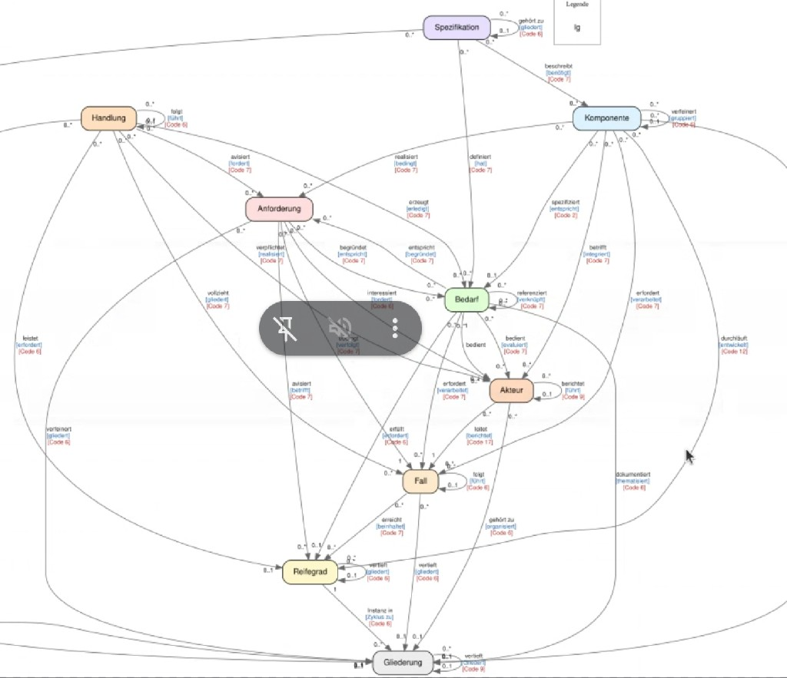

# Meta-model comparison: diagram vs. Elementplan vs. pragmatic BIM data contract

The diagram is a generic meta-model for information requirements. Its main chain is Need (Bedarf), then Requirement (Anforderung), then Component (Komponente), then Maturity level (Reifegrad), with Actor (Akteur) and Breakdown (Gliederung) connected to almost everything.

Most of its concepts already exist in Elementplan or in the [pragmatic BIM data contract](https://schema.pragmaticbim.ch/). Three parts do not:

- actors
- specification documents as the source of requirements
- a split between a use case and the actions inside it

## Reading the diagram

Part of the source diagram is covered by video controls, so the edges around Anforderung, Fall and Akteur are partly guessed.

The edge codes look like relation categories:

- Code 6 is used for hierarchy and ordering edges (gehört zu, verfeinert, folgt, vertieft, gliedert).
- Code 7 is used for dependencies between concepts.
- Codes 2, 9, 12 and 17 are used for special cases.

This reading of the codes is an inference, not stated in the diagram.

## How the concepts map

| Diagram | Elementplan | Pragmatic BIM data contract |
|---|---|---|
| Bedarf (need) | `ProjectGoal`, `UsageScenario` | `BriefRequirement` (partly) |
| Anforderung (requirement) | `Attribute`, `AttributePreset`, `PerformanceTarget`, `DocumentRequirement` | `Requirement` subclasses (Performance, Spatial, Identification, Material, Regulatory, Deliverable, …) |
| Komponente (component) | `Element`, `RoomType` | `PhysicalElement`, `Space`, `System`, `Equipment` |
| Spezifikation | partly `RoomTypeConfiguration`, `ValueSet.norm_reference` | `Artifact` via `Requirement.source_artifact`; `RegulatoryRequirement.norm_uri` |
| Fall (case) | `Workflow` (the Anwendungsfall) | `Process` (a running instance) |
| Handlung (action) | none | `Task` |
| Akteur (actor) | none, by design | `Agent`, `Person`, `Company`, `PersonRelationship` |
| Reifegrad (maturity level) | `Phase`, `Milestone`, `needed_in_phases`, `needed_for_models`; also `ProjectGoalLevel` | `ScheduleRequirement`, `TimeRecord`, `StatusType` |
| Gliederung (breakdown) | `Domain`, `Model` / `Document`, `PhaseScheme`, `Use`, `workflow_group`, `tags` | `Classification` (scheme + code, SKOS), `SpatialContext` hierarchy |

## Where the models agree

- **A need is met by a component.** "Komponente spezifiziert Bedarf" is what `ScenarioOption.adds` → `RoomType` does in Elementplan.
- **A need justifies a requirement.** "Bedarf begründet Anforderung" is Elementplan's goal → workflow → attribute chain. The README calls this link the hard part. The diagram has the same link, but without the workflow step in between.
- **A requirement targets a maturity level.** "Anforderung avisiert Reifegrad" is `Attribute.needed_in_phases`.
- **A component passes through maturity levels.** "Komponente durchläuft Reifegrad" is `Element.needed_for_models`, which maps each container to its phases.
- **Maturity levels form cycles in a breakdown.** "Reifegrad Instanz in Gliederung (Zyklus zu)" is `Phase` belonging to a `PhaseScheme`, plus `PhaseMapping` between schemes.
- **Cases follow each other.** "Fall folgt Fall" is `Workflow.parent_workflow`. Elementplan only models hierarchy here, not sequence.

## Where they differ

1. **Actors.** The diagram makes Akteur central: a requirement obliges an actor, a need serves an actor, actors report to each other, and actors belong to an organisational breakdown. Elementplan deliberately leaves out roles; the `Model` and `Document` descriptions exclude responsible party, reviewer and approver. The contract has the actor classes, but nothing in Elementplan points to them. This is the largest gap if the diagram is the target.
2. **Specification as the source of a requirement.** In the diagram, a Spezifikation (norm, brief, product spec) defines needs and describes components. Elementplan only has `norm_reference` on `ValueSet`. `Attribute`, `ProjectGoal` and `Workflow` cannot say which document or norm they come from. The contract covers this with `source_artifact` and `norm_uri`.
3. **Use case versus action.** The diagram separates Fall (the case) from Handlung (the steps). Handlung creates needs, targets requirements and delivers maturity. Elementplan stops at `Workflow` and has no step level; the contract's `Task` and `Process` are runtime records, not catalog templates.
4. **Two kinds of "level".** Elementplan has two ordinal axes: `ProjectGoalLevel` (how ambitious, e.g. grosszügig → sensitiv) and `Phase` / `Milestone` (how mature over time). The diagram has only Reifegrad, which mixes the two. Keeping them separate, as Elementplan does, is cleaner.
5. **Breakdown as one class or many.** The diagram uses a single Gliederung class with a hierarchy edge from almost every entity. Elementplan uses several specific groupings, and the contract uses external SKOS schemes. The specific groupings are easier to validate. The diagram's approach only fits if one navigation tree across everything is wanted.
6. **Edge density and direction.** The diagram has about 35 edges, mostly 0..* and named in both directions. Elementplan stores one direction per link (for example, `excludes` is declared on one side only) and keeps the chain from intent to delivery linear. Inverse names in the diagram could become LinkML `inverse` declarations, but most cross-links (for example Komponente → Akteur, Handlung → Bedarf) have no counterpart and would make the model much less strict.

## Suggested changes for alignment

- **Actors:** add an optional responsible-role reference on `Workflow` (and perhaps `Model` / `Document`), pointing at the existing roles classification as scheme + code. That covers Anforderung → Akteur without importing the contract's `Agent` classes.
- **Sources:** add an optional `source_reference` or `norm_reference` to `Attribute`, `ProjectGoal` and `PerformanceTarget`, aligned with `Requirement.source_artifact` and `norm_uri` in the contract.
- **Steps:** add Handlung only if workflows need step-level templates. Otherwise leave it to the contract's `Task` / `Process`.
- **Breakdown and density:** do not add a generic Gliederung class or the many cross-edges.
